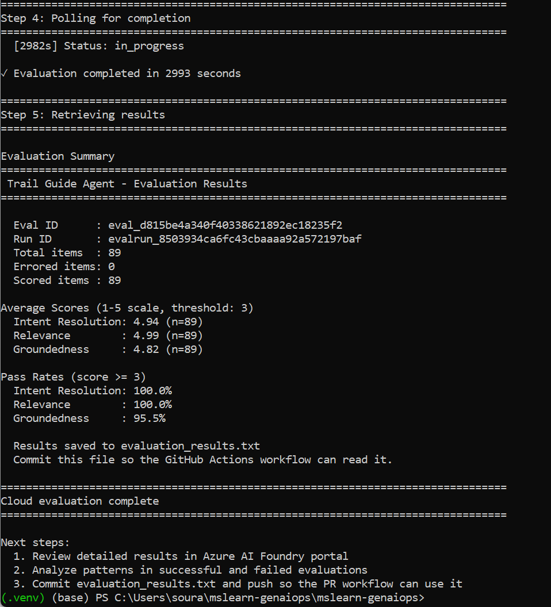
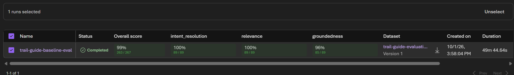
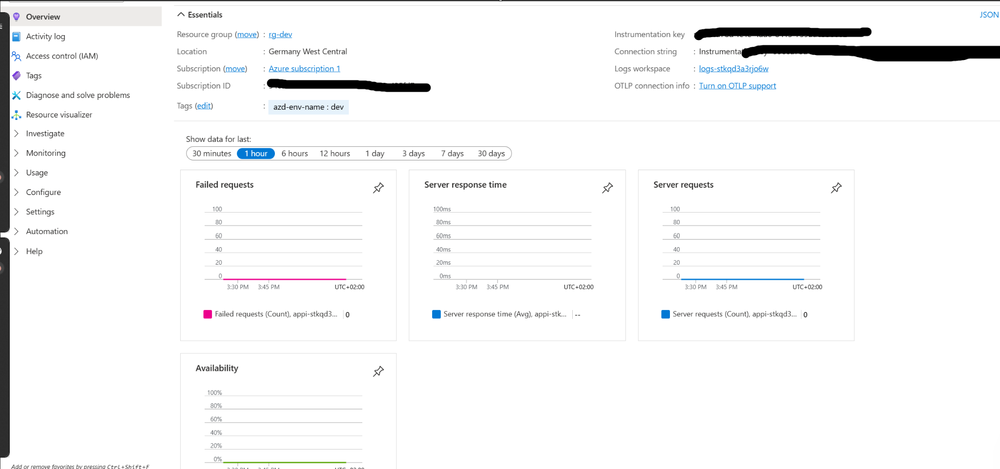
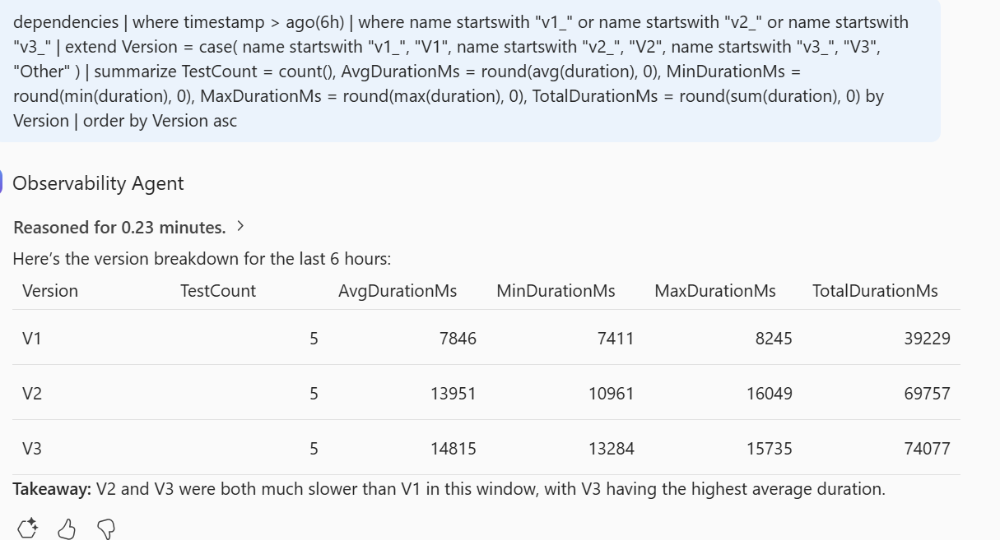
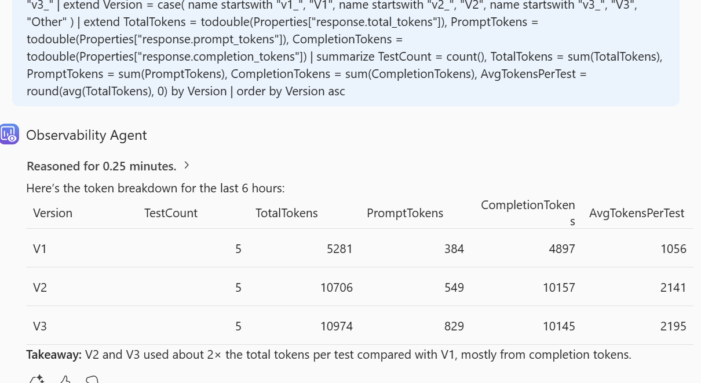

# AI-300 GenAIOps Hands-On Lab with Microsoft Foundry

Hands-on GenAIOps exercises completed while preparing for the **Microsoft Certified: Machine Learning Operations Engineer Associate (AI-300)** certification.

This repository documents my practical work with **Microsoft Foundry**, covering infrastructure provisioning, agent and prompt iteration, cloud evaluation, CI/CD authentication, tracing, and production-oriented observability.

> **Scope:** This repository is based on the official Microsoft Learn GenAIOps lab/template. It documents the exercises I configured, executed, tested, and troubleshot during AI-300 preparation. It is a learning repository rather than a production application.

---

## Overview

The exercises follow a GenAIOps lifecycle in which a generative AI application is not treated as a one-time prompt, but as a versioned and measurable software system.

```text
Infrastructure as Code
        ↓
Microsoft Foundry Project
        ↓
Model Deployment
        ↓
Trail Guide Agent
        ↓
Prompt / Agent Versions
        ↓
Automated Evaluation
        ↓
Quality Gates
        ↓
Tracing + Application Insights
        ↓
Latency / Token Observability
        ↓
CI/CD and Iteration
```

The lab uses a **Trail Guide Agent** as the example application and progressively adds version management, evaluation, automation, and observability.

---

## What I Practiced

### 1. Microsoft Foundry Infrastructure

I provisioned the lab environment with Azure Developer CLI (`azd`) and the infrastructure definitions included in the Microsoft Learn repository.

The environment included resources for:

- Microsoft Foundry
- Foundry project
- Model deployment
- Application Insights
- Log Analytics
- Supporting Azure resources

This reinforced the use of **Infrastructure as Code** and repeatable environments rather than creating every resource manually.

---

### 2. Agent and Prompt Versioning

I worked with multiple versions of the Trail Guide Agent and iterated on its instructions instead of modifying one prompt without version history.

The iterations were used to compare changes in:

- response behavior
- safety and instruction-following
- response length
- latency
- token consumption

This made prompt changes measurable rather than subjective.

```text
V1  → baseline behavior
V2  → expanded / personalized behavior
V3  → more structured recommendations and safety-oriented instructions
```

The exact behavior of each version can then be tested against the same prompts and compared using evaluation and telemetry.

---

### 3. Cloud Evaluation

I created and ran a cloud evaluation for the Trail Guide Agent using evaluators for:

- **Intent Resolution**
- **Relevance**
- **Groundedness**

The evaluation ran against **89 items** and produced aggregate scores and pass rates.



For this lab run, the evaluation completed with no errored items and produced strong aggregate scores across the three evaluators.

> These scores represent one lab evaluation run and are included as evidence of the evaluation workflow, not as a benchmark claim.

---

### 4. Evaluation Results in Microsoft Foundry

The evaluation results were also reviewed in the Microsoft Foundry portal.



This view makes it possible to compare evaluator results and inspect whether an application meets the selected quality threshold before promotion.

The workflow reinforced an important GenAIOps pattern:

```text
Change prompt / agent
        ↓
Run evaluation
        ↓
Inspect quality metrics
        ↓
Apply pass / fail criteria
        ↓
Promote or iterate
```

---

### 5. Tracing with Application Insights

I used tracing and Application Insights to inspect how requests moved through different agent-version executions and model calls.



The trace view exposed individual operations and their durations, helping connect a user-facing response to the underlying model invocation.

This is useful for diagnosing:

- slow requests
- model-call latency
- dependencies
- version-specific behavior
- operational regressions

---

### 6. Version-Level Latency Analysis

I compared latency across the V1, V2, and V3 test runs.



In this captured run, the later versions took longer on average than V1. This demonstrates why prompt improvements should be evaluated not only for quality but also for their operational cost and responsiveness.

The exercise connected telemetry to questions such as:

- Did a prompt change increase response time?
- Is the increase consistent across requests?
- Which version has the largest latency?
- Is the quality improvement worth the operational trade-off?

---

### 7. Token Usage and Cost-Oriented Observability

I also compared prompt, completion, and total token usage across agent versions.



The observed V2 and V3 runs consumed roughly twice the total tokens per test compared with V1, mostly because of larger completion-token usage.

This highlighted an important GenAIOps principle:

> A prompt version can produce better behavior while also increasing latency and token cost.

Quality, latency, and consumption therefore need to be evaluated together.

---

### 8. CI/CD Authentication with OIDC

As part of the automation exercises, I configured GitHub-to-Azure authentication using **federated identity credentials / OpenID Connect (OIDC)**.

The workflow avoids depending on a long-lived Azure client secret and follows the pattern:

```text
GitHub Actions
      ↓
GitHub OIDC token
      ↓
Federated identity credential
      ↓
Microsoft Entra workload identity
      ↓
Azure RBAC
      ↓
Microsoft Foundry resources
```

I configured separate federation scenarios for the main branch and pull-request workflow used in the lab.

> Screenshots containing application IDs and identity metadata are intentionally not included in this README.

---

## Repository Structure

The repository follows the Microsoft Learn GenAIOps project structure:

```text
.
├── .github/                   # GitHub Actions workflows
├── data/                      # Evaluation/test data
├── docs/                      # Microsoft Learn lab documentation
├── infra/                     # Infrastructure-as-Code definitions
├── src/                       # Agents, evaluation and test code
├── docs/
│   └── images/                # Screenshots used by this README
├── azure.yaml                 # Azure Developer CLI project configuration
├── evaluation_results.txt     # Evaluation output used by automation
├── requirements.txt           # Python dependencies
└── README.md
```

### README Images

Store the screenshots used by this README under:

```text
docs/images/
├── cloud-evaluation-complete.png
├── foundry-evaluation-overview.png
├── application-insights-traces.png
├── observability-latency.png
└── observability-token-usage.png
```

Using descriptive filenames instead of raw screenshot timestamps makes the repository easier to maintain.

---

## Technologies and Tools

- **Microsoft Foundry**
- **Azure Developer CLI (`azd`)**
- **Azure CLI**
- **Python**
- **GitHub Actions**
- **OpenID Connect (OIDC)**
- **Microsoft Entra ID**
- **Azure RBAC**
- **Application Insights**
- **Log Analytics**
- **Generative AI evaluation**
- **Prompt / agent versioning**
- **Tracing and observability**

---

## Evaluation and Observability Flow

The practical workflow used in the lab can be summarized as:

```text
Prompt / Agent Version
        ↓
Automated Test Dataset
        ↓
Cloud Evaluation
        ├── Intent Resolution
        ├── Relevance
        └── Groundedness
        ↓
Evaluation Result / Quality Gate
        ↓
Production-style Test Execution
        ↓
Application Insights Traces
        ↓
KQL / Observability Analysis
        ├── Latency
        └── Token Usage
```

This was one of the most useful parts of the lab because it connected **GenAI quality evaluation** with **runtime observability**.

---

## Key Takeaways

Working through the lab reinforced several practical GenAIOps principles:

- **Prompt changes should be versioned and evaluated, not changed ad hoc.**
- **Evaluation measures application quality before deployment or promotion.**
- **Groundedness, relevance, and task success measure different aspects of behavior.**
- **A higher-quality response can also consume more tokens and take longer to generate.**
- **Tracing helps explain where latency occurs inside an AI application.**
- **Application Insights and telemetry complement offline evaluation.**
- **OIDC enables CI/CD authentication without storing a long-lived Azure client secret.**
- **Infrastructure as Code makes cloud environments easier to reproduce.**
- **Quality, reliability, latency, and cost should be considered together when operating GenAI applications.**

---

## Learning Context

This repository was created from / based on the official Microsoft Learning **mslearn-genaiops** lab material and then used for my own hands-on AI-300 preparation.

I used the provided project structure and lab scenarios to practice provisioning, prompt iteration, evaluation, automation, authentication, tracing, and observability.

Official Microsoft Learning repository:

https://github.com/MicrosoftLearning/mslearn-genaiops

This README is intended to clearly distinguish the Microsoft-provided lab structure from the work I performed while completing and troubleshooting the exercises.

---

## Resource Status

Cloud resources used during hands-on learning may be deprovisioned after completion to avoid unnecessary Azure charges.

The screenshots in this repository preserve evidence of successful evaluation and observability runs even if the corresponding temporary Azure resources are later removed.

---

## Security Note

Before publishing a lab repository, I avoid committing or displaying:

- `.env` files
- client secrets
- access keys
- connection strings
- SAS tokens
- personal access tokens
- unredacted subscription or tenant information
- instrumentation / telemetry connection strings
- credentials embedded in scripts or workflow files

Some screenshots taken during the exercises contain identity IDs or telemetry connection information and are intentionally **not** included in the public README package.

---

## Related AI-300 Hands-On Work

For my Azure Machine Learning / classical MLOps exercises:

**[AI-300 MLOps Hands-On Lab](https://github.com/sourav0208/ai300-mlops-lab)**

Together, the two repositories document my hands-on practice across both:

```text
MLOps   → training, MLflow, deployment, monitoring
GenAIOps → prompt/agent versioning, evaluation, tracing, observability
```

---

## Next Steps

Potential extensions beyond the Microsoft Learn exercises:

- Build an independent GenAI application using the same evaluation pipeline
- Add explicit CI/CD quality gates that block promotion when evaluation scores fall below a threshold
- Compare prompt versions on quality, latency, and token cost in one automated report
- Add regression datasets for failure cases discovered during evaluation
- Add deployment environments for dev/test/prod
- Extend observability with automated alerts for latency or quality regressions

---

## Author

**Sourav**

M.Sc. Computational Mechanics — Technical University of Munich  
Interested in Scientific Machine Learning, AI for Engineering, MLOps, GenAIOps, and production AI systems.
